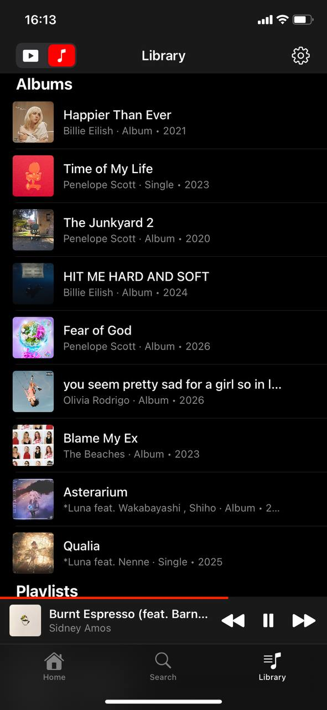
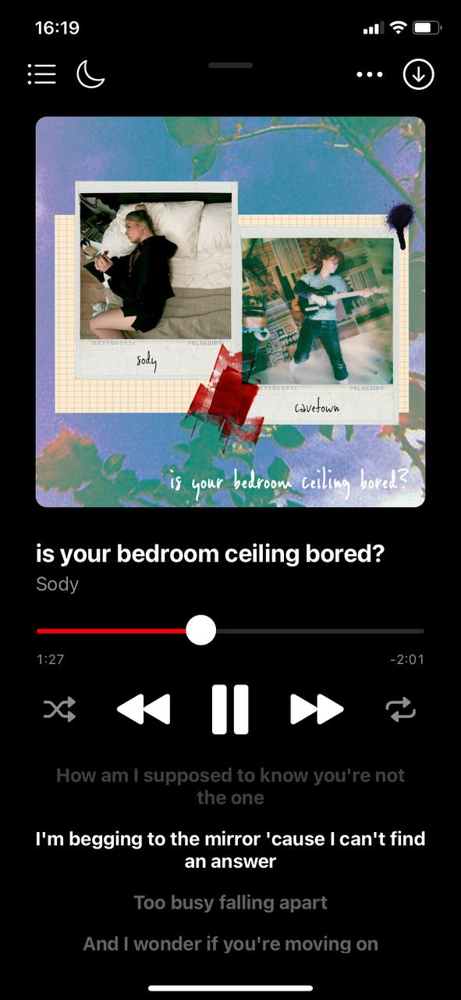
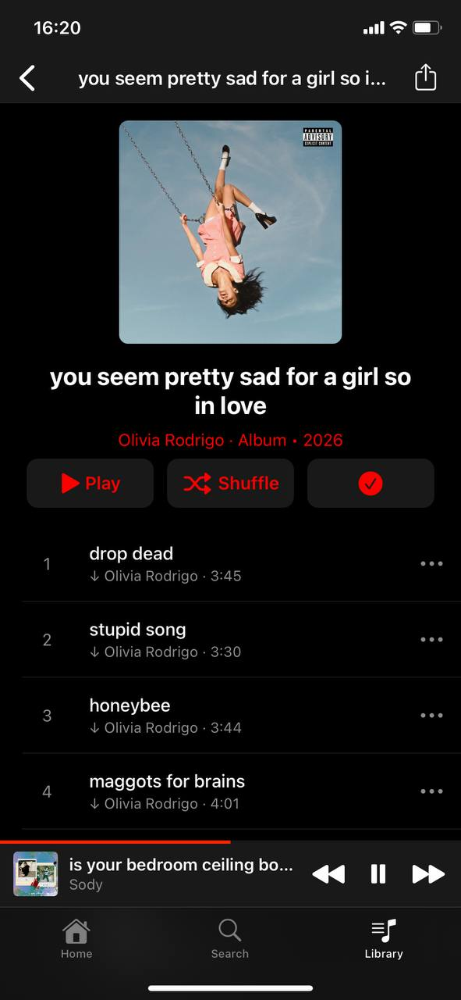
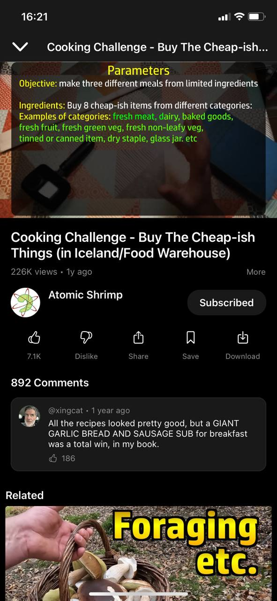

<div align="center">


# Girasol

**A YouTube Music and YouTube app for iPhones on iOS 14.**


[](LICENSE)

<!-- Screenshots: drop the images into screenshots/ under these names. -->





</div>

Girasol is two apps in one: a music player in the style of YouTube Music, and a YouTube
video app. A switch at the top of every screen moves between them.

It is based on [Opaline](https://github.com/verback2308/Opaline), a YouTube app for older
iPhones and iPads. Girasol adds the music player and takes out Shorts. It is built for
iOS 14 and tested on an iPhone XR with iOS 14.3. You can build it on Linux; no Mac is
needed.

## Music

Music mode has its own Home, Search and Library, a bar showing what is playing, and a
full-screen player with the queue, shuffle and repeat.

**Playback**
- **No gaps between songs.** The next song is loaded before the current one ends, so albums
  play the way they were recorded.
- **Music keeps going.** When an album or playlist ends, a mix based on what you have been
  listening to plays next.
- **Songs, not music videos.** YouTube Music often plays a song's music video, which can be
  a different version (with an intro, or a radio edit). Girasol plays the album version
  instead.
- **Even volume.** Songs mastered louder than others are turned down to match.
- **Crossfade**, if you want it (3 to 12 seconds). Albums still play without gaps.
- **Sleep timer**: after 15 to 90 minutes (fading out slowly), at the end of the song, or at
  the end of the album or playlist.
- **Switch modes without stopping.** A song keeps playing while you watch videos, and a video
  keeps playing in a small window while you browse music.
- **Picks up where you left off.** The queue, the album or playlist and the position are
  still there after the app is closed.

**Lyrics**
- **Synced lyrics** that follow the song, from YouTube Music, LRCLIB and NetEase. A song with
  no reliable match shows no lyrics rather than the wrong ones. Tap a line to jump to it, and
  shift the timing for a song if it is off. Lyrics are saved for offline use.
- **Japanese names as written.** Japanese songs, artists and albums keep their original
  names instead of YouTube Music's romanized ones. You can turn this off.

**Offline and data**
- **Downloads.** Save songs, albums and playlists to listen offline (audio only). Saved
  playlists download newly added songs on Wi-Fi, and an interrupted download picks up again
  by itself.
- **Recently played songs are kept.** Songs are saved as they play (up to 512 MB by default;
  you can change this or turn it off). A song you play again starts instantly, uses no data
  and works offline. The songs you play most are kept longest.
- **Light on mobile data.** Large artwork and finishing partly saved songs wait for Wi-Fi.
- A **Storage** screen shows how much space downloads and saved songs take.

**Your library**
- **Playlists**: create, rename and delete them, and add, remove and reorder songs. Share a
  playlist or album, and see whether each playlist is public, unlisted or private.
- **Spotify playlists**: copy a playlist's link in Spotify and open it in Girasol. Each track
  is looked up on YouTube Music; tracks it does not have are marked as missing rather than
  swapped for something similar. Play the playlist as it is, or save it as a YouTube Music
  playlist.
- **Speed dial and Listen again** on the Home screen, based on what you play most.

**Signing in is optional.** Without a YouTube Music account, everything above works except
what needs your account: signing in adds your personal Home screen, your library and
history, and editing your playlists.

## Video

Opaline's video app, without Shorts:
- Home, Subscriptions, channels, search with filters, playlists, and watch history synced
  with your YouTube account.
- Up to 1080p, playback in the background, Picture in Picture, subtitles, and a choice of
  audio language where a video has several.
- SponsorBlock (skips sponsor segments), comments, autoplay, and downloads for offline
  viewing.
- **No Shorts.** There is no Shorts tab or Shorts feed. Shorts from channels you subscribe to
  show up only in Subscriptions and on the channel's page, as ordinary videos.
- English interface only.

You can sign in with your YouTube account (by entering a code at google.com/device) for your
subscriptions, history and playlists, or continue without an account.

## Install

Girasol is installed as an `.ipa` file with [TrollStore](https://github.com/opa334/TrollStore).
There are no prebuilt releases yet: build the file yourself (see below), copy it to the
iPhone and open it in TrollStore.

**Coming from Opaline?** Girasol installs next to it as a separate app. The first time it
starts, it offers to import everything from Opaline in one tap: settings, sign-ins, music
and downloads (later, from Settings → Import from Opaline). Opaline itself is left as it
was.

For AppSync or other installers that keep apps sandboxed, there is a sandboxed build (see
below). It works the same, except that it cannot import from Opaline.

## Build on Linux

You don't need Theos itself. The build only uses a toolchain and an SDK, and expects them
where [Theos](https://theos.dev) would keep them:

- a Swift 5.8 toolchain for building iOS apps on Linux (with `swiftc`, `clang` and `ldid`),
  in `~/theos/toolchain/swift-5.8/linux/iphone`;
- the **iOS 14 SDK** (`iPhoneOS14.*.sdk`, for example from
  [theos/sdks](https://github.com/theos/sdks)) in `~/theos/sdks/`. A newer SDK builds an app
  that crashes on iOS 14;
- `make`, `python3` and `zip`.

They can live elsewhere: `make THEOS=<folder>` changes the `~/theos` part, or give each one
directly with `SWIFT_TC=<toolchain>` and `SDKROOT=<sdk>` (the SDK folder must keep its
`iPhoneOS14.x.sdk` name: the build reads the version from it).

```bash
make ipa                # builds build/Girasol_<version>.ipa (for TrollStore)
make ipa SANDBOX=1      # builds build/Girasol_<version>_sandboxed.ipa
make release            # builds both
make ipa DEBUG=1        # an unoptimized build, Girasol_<version>_debug.ipa
make ipa JOBS=8         # use 8 parallel jobs (the default is 16)
```

The version comes from the `VERSION` file. On GitHub, every push to `main` is built
(`.github/workflows/build.yml`): when `VERSION` names a version that has no release yet, both
IPAs are built and published as that release; otherwise a debug IPA is attached to the run.

The first build takes about a minute; after that, only changed files are rebuilt.

To install from the iPhone over Wi-Fi, `make publish` builds the app and copies it, together
with an install page, to `/srv/http/files/girasol/`. Run a web server on the computer that
serves `/srv/http` on port 80, so the page is at `http://<the computer's IP>/files/girasol/`
(the install link expects that address). Open the page on the iPhone and tap **Install** to
open the app in TrollStore.

## Privacy

Girasol has no ads, analytics or tracking. It connects to:

- **YouTube and YouTube Music**, for everything you browse and play. Your sign-ins are stored
  in the iOS Keychain and sent only to Google.
- **LRCLIB and NetEase**, which receive the title and artist of the song you are playing, to
  find lyrics.
- **Spotify**, only when you open a Spotify playlist link, to read that playlist.
- **SponsorBlock**, which receives the ID of the video you are watching, if SponsorBlock is
  on.
- **A solver server, only if you set one** (Settings → Debug → Solver server). One of the
  backup ways of playing a video can use it; it receives a technical value from YouTube's
  player, nothing about you or what you watch. Released builds have none set.

## Reporting problems

In Settings → Debug, **Share log** saves a log of what the app did (playback, network, cache)
that you can attach to a bug report.

## Credits

- [Opaline](https://github.com/verback2308/Opaline) by verback2308, the app Girasol is based
  on.
- [yt-dlp](https://github.com/yt-dlp/yt-dlp) and its [EJS](https://github.com/yt-dlp/ejs)
  solver, the reference for how YouTube playback works.
- [ytmusicapi](https://github.com/sigma67/ytmusicapi), the reference for YouTube Music's
  web interface.
- [LRCLIB](https://lrclib.net) and NetEase Cloud Music, for lyrics.
- [SponsorBlock](https://sponsor.ajay.app), for sponsor segments.

## Legal

For personal and educational use. Girasol is not affiliated with, endorsed by or connected
to Google, YouTube or Spotify.

## License

[GNU General Public License v3.0](LICENSE), like Opaline. Anything based on Girasol must also
be released under GPLv3, with its source code.

The changes Girasol makes to Opaline are also dedicated to the public domain under
[CC0 1.0](LICENSES/CC0-1.0.txt): you may use that code in any way, without conditions. Files
that are entirely Girasol's start with `SPDX-License-Identifier: CC0-1.0`. Opaline's own code
stays under GPLv3 only, so the app as a whole, and any part that includes Opaline's code,
remains GPLv3.
